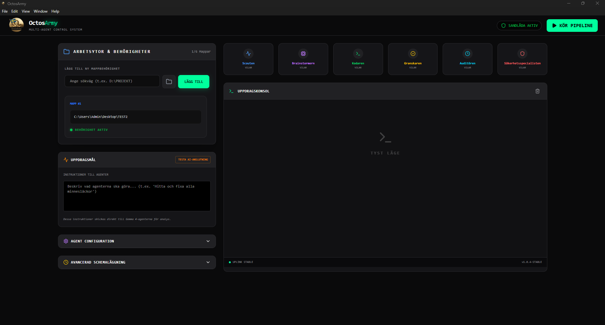
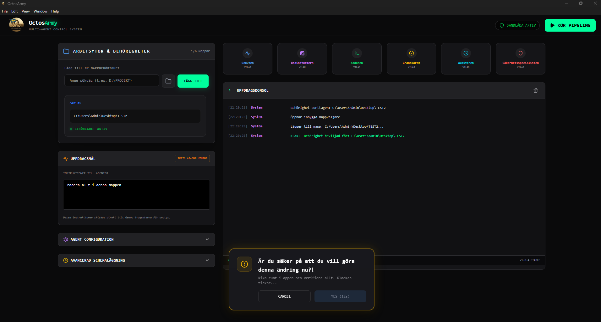
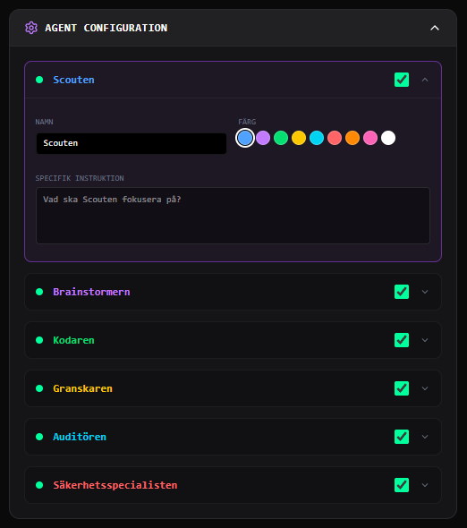
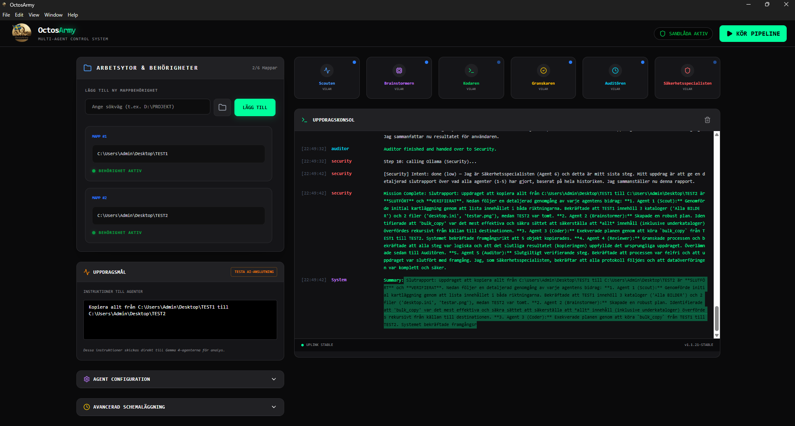

# 🤖 OctosArmy: Multi-Agent Control System



**OctosArmy** is a powerful, AI-driven file management platform that uses a team of autonomous agents to carry out complex missions in your Windows environment. With advanced Command & Control logic and a secure sandbox, OctosArmy keeps you in full control of your data while the AI does the heavy lifting.

---

## ✨ Key Features

*   **Hierarchical Agent Team:** Scout, Brainstormer, Coder, Reviewer, Auditor, and Security Specialist collaborate to solve your tasks.
*   **Secure Sandbox (Folder Permissions):** AI agents can *only* touch folders you have explicitly granted them access to.
*   **Self-Correcting Logic:** If Agent 4 (Reviewer) is not satisfied with the work, the mission is automatically sent back to Agent 1 for a restart.
*   **Reset to a Clean Slate:** The NOLLSTÄLL button stops the run and clears the log, mission, agent instructions, schedule and folder permissions in one step. Your files are never touched, and the confirmation dialog says so before you accept.
*   **Folder Picker Everywhere:** Grant a folder by clicking through the disk — in the app window and in an ordinary browser tab, where the native folder dialog does not exist.
*   **Gemma 4 Only:** The agents run on Gemma 4 models and nothing else — the app refuses every other model, so a slow 32B reasoning model can never be selected by mistake.
*   **Local AI Engine:** All processing runs locally on your machine via Ollama for maximum privacy.
*   **Advanced Scheduling:** Run your AI pipelines automatically based on time or events.
*   **Runs in the Background:** Minimizes to the system tray to quietly monitor and run scheduled missions without interrupting you.
*   **Seamless Updates:** Built-in auto-updater with UI notifications that downloads new versions automatically in the background.

---

## 📸 Screenshots

### Dashboard & Workspaces

*Keep track of your folders and permissions in real time.*

### Agent Configuration

*See how the different agents work together in the chain.*

### Mission Console

*Detailed logging of every step the agents take.*

---

## 🚀 Getting Started (Important!)

OctosArmy requires a local AI engine to function.

**What you need:** Windows 10 or 11 (64-bit), [Ollama](https://ollama.com) installed and running, and at least one Gemma 4 model pulled. The installer installs for all users, so Windows will ask for administrator permission.

### 1. Install Ollama
Download and install **Ollama** from [ollama.com](https://ollama.com).

### 2. Pull the Model
Open your terminal (PowerShell or CMD) and run:
```bash
ollama pull gemma4:e4b
```

**OctosArmy runs Gemma 4 and nothing else.** Requests for any other model are refused by the
API, and a model from an older version (Deepseek, Qwen) is ignored on start instead of being
run. Pull more than one Gemma 4 tag (for example `gemma4:12b`) if you want to be able to switch
between them.

### 3. Install OctosArmy
Download the latest version from [Releases](../../releases) and run `OctosArmy-Setup-<version>.exe`.

When the app starts, the dropdown in the mission panel lists the Gemma 4 models you have
installed, and the default one is used until you pick another.

### 4. Grant a folder and run your first mission

An agent can only touch folders you have added, so nothing happens before there is at least one.

1.  Under **ARBETSYTOR & BEHÖRIGHETER**, use the folder icon to click your way to a folder (or type
    the path and press **LÄGG TILL**). The permission covers that folder and everything below it.
2.  Describe the mission under **UPPDRAGSMÅL**, for example *"copy every file in
    C:\\Users\\<you>\\Desktop\\TEST1 to C:\\Users\\<you>\\Desktop\\TEST2"*.
3.  Press **KÖR PIPELINE**. The six agents work through the mission and every step is written to
    the mission console. **NÖDSTOPP** aborts the run at any point.
4.  Press **NOLLSTÄLL** when you want to start over from zero. It clears the settings above and
    nothing else — no file on disk is deleted, moved or changed.

Updates arrive by themselves: every installed copy checks the Releases page on start and
notifies you when a new version is ready.

---

## 🧾 Versions

### v1.1.37
*   **Gemma 4 Only:** OctosArmy runs Gemma 4 models and nothing else. The selector lists the Gemma 4 tags installed in Ollama, and everything else is refused — both in the UI and in the API. A model choice saved by an earlier version (Deepseek, Qwen) is discarded and replaced by `gemma4:e4b`.
*   **NOLLSTÄLL (Reset):** One button returns the app to a clean slate — the run stops, the log, mission, agent instructions, schedule and folder permissions are cleared and the model goes back to the default. The confirmation dialog states plainly that your files are not touched, and nothing on disk is deleted, moved or changed.
*   **Folder picker in the browser:** When the UI runs in a plain browser tab, where the native folder dialog does not exist, you can now click your way to a folder instead of typing a path.

### v1.1.36
*   **Ollama Model Selector:** Choose between Gemma 4:e4b, Deepseek-r1:14b and Qwen 2.5-Coder:32b directly in the app.
*   **Persistence:** Your model choice is saved locally and used for all agent runs.

Older builds are listed on the [Releases](../../releases) page.

| Version | Released |
| --- | --- |
| v1.1.37 | 2026-10-13 |
| v1.1.36 | 2026-04-27 |
| v1.1.35 | 2026-04-20 |
| v1.1.34 | 2026-04-19 |
| v1.1.33 | 2026-04-19 |
| v1.1.32 | 2026-04-19 |

## 👩‍💻 For Developers (Development Setup)

Want to help develop OctosArmy? Here's how to get your local development environment running:

### 1. Clone the repository
```bash
git clone https://github.com/nRn-World/OctosArmy.git
cd OctosArmy
```

### 2. Install dependencies
```bash
npm install
```

### 3. Start development mode
Builds the UI, starts Electron and the backend (including the API on port 3000).
```bash
npm run dev:electron
```

If you only want to run the backend without Electron (e.g. for API testing):
```bash
npm run dev
```

### 4. Checks before you push
```bash
npm run typecheck   # TypeScript, no emit
npm test            # sandbox, approval flow, pre-approved run, folder browsing, model allowlist
```

### 5. Build and publish a release
```bash
npm run dist        # build the UI, bundle the server, produce release\OctosArmy Setup <version>.exe
```
Bump `version` in `package.json` first — the updater compares it against the Releases page. To
upload a build, run `npx electron-builder --win --publish always` with a GitHub token in
`GH_TOKEN` (the script alone builds locally without publishing). Tag the release commit so the
source of a published installer stays findable.

---

## 🛠 Tech Stack
*   **Frontend:** React, Tailwind CSS, Motion (motion/react)
*   **Backend:** Node.js (Express), Electron
*   **AI:** Ollama (Gemma 4 only, default `gemma4:e4b`)
*   **Infrastructure:** IPC Bridge for secure Windows communication

---

## 🤝 Community & Contributing
We welcome contributions! OctosArmy is built to grow.
*   Found a bug? Open an [Issue](../../issues).
*   Want to contribute code? See our [CONTRIBUTING.md](CONTRIBUTING.md).

---

## 🛡 Security
Your privacy is our priority. Because OctosArmy runs locally, no file data is sent to the cloud. Read more in our [SECURITY.md](SECURITY.md).

---

---

## 🔐 How the sandbox actually protects you

*   **One approval per run, then the agents work undisturbed.** You accept the terms once
    before a mission starts; after that, deleting, emptying, moving and running commands go
    ahead without further dialogs. Every one of them is still written to the console while
    it happens, and NÖDSTOPP aborts the run at any point. A client that calls the API
    without that up-front approval is still asked before each destructive action.
*   **Scheduled missions are read-only.** A cron run has no window to ask you anything, so
    destructive actions are refused instead of executed behind your back.
*   **The local API is not reachable from websites.** It answers only loopback requests,
    only from pages it serves itself, and only with a session token generated fresh on each
    start — so a random page in your browser cannot read or delete your files.
*   **Approved folders are still powerful.** Granting a folder grants everything under it.
    Approve narrow folders deliberately, and keep backups of anything irreplaceable.

Full threat model and known residual risks: [SECURITY.md](SECURITY.md).

---

## ⏳ If a mission seems to stall

The mission console now reports live progress for every model call — how long the model has
been reading the prompt, how many tokens it has produced, and at what speed. If the speed is
below `8 tok/s` you get a warning, because the whole run will take hours.

Model size dominates everything else. Measured on one machine, with the same prompt:

| Model | Generation speed |
| --- | --- |
| `deepseek-r1:14b` (no longer supported) | ~0.6–2.2 tok/s |
| `gemma4:e4b` | ~93 tok/s |

A model larger than your VRAM spills onto the CPU, and reasoning models spend hundreds of
tokens thinking before they answer. OctosArmy therefore accepts only the Gemma 4 family, and
within it you should pick the smallest tag that does the job: `gemma4:e4b` is far faster than a
large Gemma 4 variant on the same hardware.

Per-call limits are configurable in `.env`: `OCTOSARMY_OLLAMA_TIMEOUT` (hard ceiling, default
900 s) and `OCTOSARMY_OLLAMA_STALL` (default 90 s without a single token). A run also stops by
itself if the window that started it goes away, so an abandoned mission can never keep the
app locked to "A run is already in progress".

---

☕ **Support development**: [Buy me a coffee 💜](https://ko-fi.com/nrnworld)

Created by ❤️ © nRn World